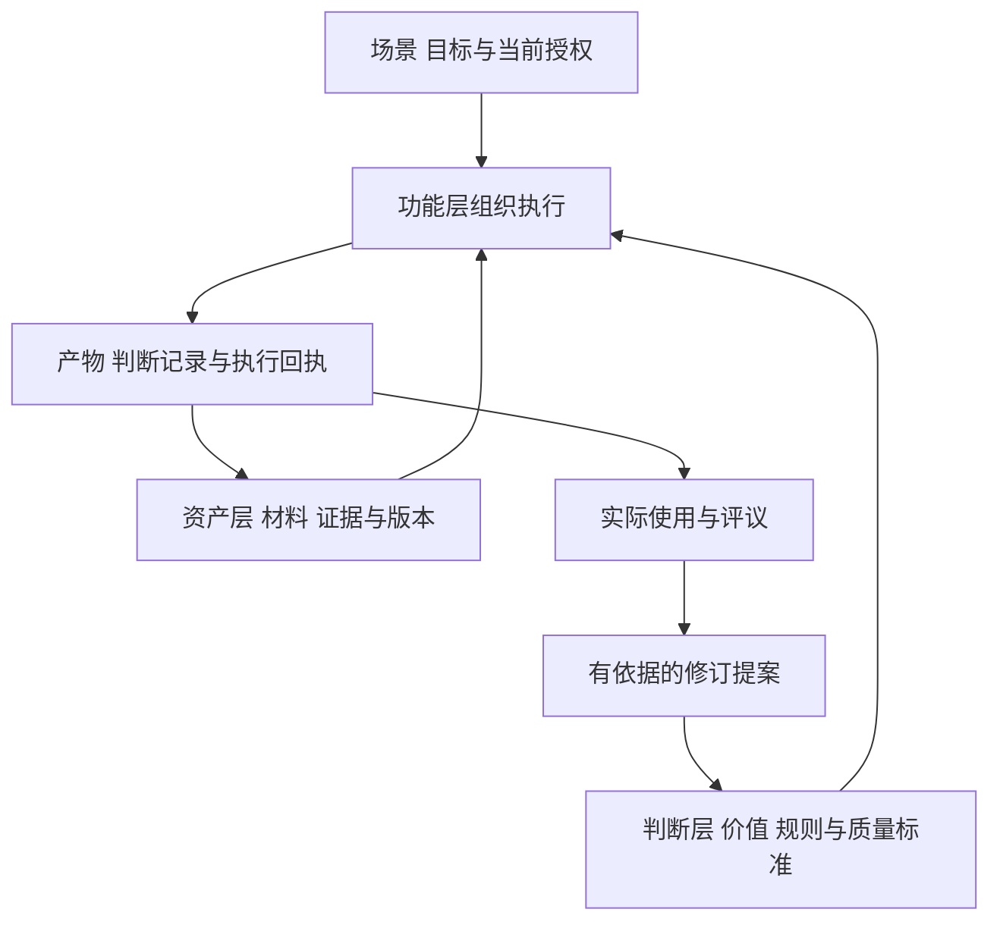

> 本文为 v0.1 非规范性参考附件。当前 Agent 入口、字段、状态和执行要求以 ../AGENTS.md、../CORE.md、../protocol.yaml 及当前 schema 为准。仅在需要历史解释时读取。

# 超维协议三层结构定义

本协议采用三个正式名称：**判断层 Judgment、功能层 Function、资产层 Asset**。历史文件中的“审美层”按原有职责映射为“判断层”；审美仍是判断的一部分，覆盖表达、形式、节奏、体验及其与目标的关系。

本版本供阅读、讨论和项目接入。三层名称为判断层、功能层、资产层；规则包格式、接入条件和开源安排为 v0.1 草案设计。

## 1 协议的定义与用途

**超维协议是一套面向人、AI 与软件协作的通用协议：通过判断层明确目标、价值、标准与取舍，通过功能层组织可授权、可执行、可检查的能力，通过资产层管理可追溯、可复用、可迁移的材料与成果，使一次交付能够被理解、执行、评议和持续改进。**

采用者拿到协议后，应能回答六个问题：服务谁、解决什么；依据什么判断；调用什么能力；使用哪些资料与版本；怎样验收；哪些成果和经验可以继续使用。

协议统一职责和协作方式。专业结论由适用的领域规则、实际证据和有权作出结论的人或系统共同形成。通用协议不预设所有行业共享一个评分表。

适用对象包括软件、Agent、Skill、研究服务、课程、内容生产、硬件应用及人工交付。小项目可用一份文档和一张记录表实现三层；复杂项目可使用独立模块、接口和存储。

## 2 三层的完整定义

| 层 | 正式定义 | 核心问题 | 主要交付 |
| --- | --- | --- | --- |
| 判断层 | 针对特定对象、场景和目标，定义价值取向、专业标准、证据要求、方法选择、质量条件与决策权限，并据此形成有依据的取舍与评议 | 为什么做、为谁做、什么值得做、什么才算合适、何时应改或停 | 判断规则包、质量量规、正反例、适用条件、判断记录 |
| 功能层 | 把目标与规则落实为明确的能力契约、交互和执行流程，负责身份与授权核验、工具与模型调用、状态管理、运行检查及结果交付 | 如何完成、谁能执行、需要什么、实际执行到哪一步 | 可调用能力、操作流程、界面、运行记录、执行回执 |
| 资产层 | 对被纳入管理的材料、方法、记录及成果建立身份、版本、来源、关联、权属与生命周期，使其可定位、可追溯并在允许范围内复用和迁移 | 用了什么、来自哪里、属于谁、哪个版本、可以怎样继续使用 | 原件、衍生物、引用、来源记录、版本关系、资产清单 |

三层是三种责任，文件数量与部署数量由项目决定。一个 PDF、一段代码或一次人工评议可以同时关联三层责任，应分别写明其标准、执行和保管方式。

## 3 判断层的定义与规范

### 3.1 判断层必须说明的事项

每个产品线的判断层至少应明确以下十项。项目简单时可以合并表达，但应让接手者读出对应含义。

| 项目 | 需要定义的内容 |
| --- | --- |
| 对象与目标 | 谁在什么条件下，需要发生什么变化；服务对象与受影响者分别是谁 |
| 价值与优先级 | 追求什么；同时存在的目标如何相处；真实冲突发生时依据什么取舍 |
| 事实与证据 | 什么材料足以支持哪类结论；事实、推断、假设、偏好如何区分 |
| 适用与排除 | 规则适用的人群、任务、阶段和环境；何时不适用、过期或需要更换 |
| 方法选择 | 为什么选某种方法、形式或路径；有哪些合理备选；选择依赖什么前提 |
| 质量与审美 | 什么算准确、有价值、完整、清楚、得体；形式怎样服务内容与使用目的 |
| 门槛与取舍 | 哪些是不可由总分抵消的要求；哪些是可比较的质量维度；哪些只是偏好 |
| 不确定与失败 | 缺证、冲突、失败及反例怎样改变结论；何时补查、返工、暂停或退出 |
| 判断与决定权限 | 谁可建议、谁可评议、谁有权确认哪类结论；哪些权限已经授予系统 |
| 学习与修订 | 怎样从反馈修订个案、领域规则或通用原则；谁维护，如何记录影响 |

### 3.2 判断规则的表达单元

一条可复用规则应有稳定编号，并写清：**适用条件、判断要求、理由、所需证据、正例、反例、缺项处理和评议方式**。规则可以采用文字、量规或确定性函数表达。

例如“反馈必须具体”仍不足以稳定执行。可操作的规则是：“对本次作品提出改进建议时，应引用具体片段，说明该片段与任务标准之间的差距，并提出学习者下一次可以实施的动作；没有作品时只提供练习建议。”

量化评分是可选工具。采用评分时，应定义分值锚点、适用范围、最低项、缺失值与校准方法。不同产品线的分数不自动可比，分数不自动转化为效果预测。

### 3.3 判断层包含的四类标准

1. **价值标准**：结果对谁有用，是否值得投入，短期完成与长期积累如何兼顾。
2. **专业标准**：结论、方法和产出在该领域怎样才成立，需要何种证据。
3. **审美与体验标准**：内容如何组织，形式、语言、声音和交互怎样帮助理解、使用与感受。
4. **决定标准**：哪些条件满足后可继续，哪些结论只到候选，何时由谁作出决定。

上述分类服务于表达完整性，不增加协议层数。审美评议仍应查看实际成品；专业评议仍应核对内容和证据。

### 3.4 判断层的输入与输出

输入包括场景、目标、实际限制、已有授权范围、候选方案、证据快照和适用规则版本。功能层负责取得并核对这些输入。

输出包括选择或评议结果、适用范围、规则编号、证据引用、简明理由、未知项、替代方案及下一步。理由应足以让他人核对结论依据，无需记录模型的内部思考过程。

判断记录是一次有范围的结论。对单个作品的认可只作用于该作品；对某条规则的修订，应另有明确的维护记录。

## 4 功能层的定义与规范

功能层负责将判断要求落实为能力。能力可以由普通代码、模型、Agent、Skill、人工或其组合实现，对外契约应说明输入、输出、限制、失败行为和验收方式。

功能层至少承担以下责任：

- 接收任务，核对身份、当前权限、范围、输入和版本。
- 选择声明适用的规则包，装配必要上下文，保留实际使用的规则版本。
- 调用工具、模型与人工环节；管理运行状态、重试、取消、恢复和资源限制。
- 执行结构、权限、完整性和质量检查；按规则区分自动检查、模型评议与人工评议。
- 在产生持久化、签名、发送、发布或设备写入等动作前，核对该动作所需的当前授权。
- 交付实际产物和执行回执；失败时保留可解释的原因与可行下一步。

**Harness 属于功能层。**这里的 Harness 指负责装配上下文、调用能力、运行检查与管理状态的执行框架。某份历史材料若以“判断层 Harness”为标题，应按内容区分：其中原则、量规与锚点归判断层，运行器归功能层。

模型提出的候选方案与确定性校验应分别记录。系统可在已授予的范围内自动作出决定；需要教师、领域负责人或作者确认的结论，应保留相应的确认环节。协议不要求每个动作都重复请求人批准。

网页、CLI、HTTP、MCP 等入口应引用同一能力契约和权限规则。因入口不同造成的能力差异，应明确声明。

## 5 资产层的定义与规范

资产是被明确纳入保管、追溯或复用管理的对象。它可以是材料、作品、方法、数据、规则包、模型输出、人工意见、运行记录或分发包。

资产层至少记录：稳定身份、对象类型、主体与项目范围、来源、版本、定位方式、父子或派生关系、使用范围及生命周期状态。软件实现还应为需要完整性校验的对象记录摘要或等效标识。

原件、解析、索引、摘要、模型观察、作品、评价和发布版本应能区分。保存模型观察时，应保留它所依据的原件和观察性质。

### 5.1 三种资产范围

| 范围 | 主要用途 | 进入更大范围的条件 |
| --- | --- | --- |
| 个人或项目资产 | 支持本人或本项目工作 | 核对新的用途、权限与敏感内容 |
| 组织共享资产 | 供限定成员重复使用 | 记录共享对象、维护者、适用范围和撤回方式 |
| 公开资产 | 供公众采用、修改或分发 | 明确可公开内容、来源与许可，完成必要处理和发布记录 |

“已经保存”只说明对象被管理。“已经公开”应另有可访问的发布位置与发布记录。引用只是定位对象的方式，读取时仍须核对当前访问权限。

### 5.2 资产生命周期

资产可经历采集、处理、评议、发布、修订、撤回、归档和删除。项目应定义哪些状态适用以及各状态允许的用途。

通常保留原件与修订关系；涉及删除、撤权和保留期限时，按已确定的用途和项目规则处理。删除后，引用解析器应返回删除或不可用状态，不能通过旧索引继续泄露正文。

## 6 三层之间怎样协作



这是责任关系与信息流。具体运行可多次读取证据、评议和返工。

在代码实现中，功能层可依赖判断规则与资产契约。判断规则应能在明确输入下被独立阅读或评议，避免隐含依赖某个数据库、模型供应商或界面。资产的身份、版本和引用机制应避免反向依赖某条业务判断。

确定性的判断函数可以放在判断模块；数据库、网络、模型调用、存储与传输适配放在功能实现。人工项目可用表单和工作步骤表达同样的责任边界。

### 6.1 容易混淆的对象

| 对象 | 三层责任的划分 |
| --- | --- |
| 评分 | 维度、权重和锚点由判断层定义；计算、评议和展示由功能层执行；评分版本与结果由资产层保存 |
| Prompt 或 Skill | 其中价值与标准归判断层；工具指令、路由和步骤归功能层；冻结版本作为方法资产保存 |
| 检索 | 什么证据足够、何时应补查由判断层定义；检索与访问核验由功能层执行；来源、索引及定位由资产层管理 |
| 界面 | 信息优先级、表达和体验标准归判断层；渲染与交互实现归功能层；图像、字体和设计版本按资产管理 |
| 权限 | 专业责任和用途限制由判断规则声明；当前身份与动作权限由功能层强制核验；使用范围和许可信息随资产记录 |
| 规则文件 | 其规范含义由判断层负责；读取、校验与应用由功能层负责；文件版本及来源由资产层保存 |

三层不要求三套独立软件，也不要求一条能力对应一个 Agent。

## 7 通用核心与产品线怎样组合

**有效的项目规则由通用核心、领域规则包和项目配置共同构成。**三者是规则的适用范围，不增加三层之外的架构层。

- **通用核心**：定义三层责任、证据与版本记录、权限执行、状态区分、反馈升级和兼容要求。
- **领域规则包**：定义伴学、科研、校园、媒体、硬件等领域中的好结果、证据门槛、质量量规、方法与反例。
- **项目配置**：填写本次对象、阶段、预算、材料、设备、风格、时间和负责人，在上位规则允许的范围内选用参数。

项目配置可收窄范围或提高质量要求。涉及改变不可覆盖规则的项目，应明确提出修订或声明为不同协议分支。多个领域包组合时，应声明各自负责的对象、重复规则的处理方式和冲突优先级；决定性冲突未解决时暂停受影响的动作，继续其他可完成工作。

通用核心固定以下十条义务：

| 编号 | 义务 |
| --- | --- |
| HD01 | 明确场景、对象、目标和交付范围 |
| HD02 | 明确适用规则、维护源、版本和决定权限 |
| HD03 | 区分事实、推断、假设、偏好与建议，重要结论可追溯 |
| HD04 | 分别定义不可抵消的门槛、可比较的质量维度和个人偏好 |
| HD05 | 功能执行服从当前权限，并如实说明可用能力和执行状态 |
| HD06 | 保存必要的来源、版本、定位与派生关系 |
| HD07 | 分别记录工程、专业、审美、人工认可和真实使用证据 |
| HD08 | 声明缺项、冲突、失败及其影响范围与处理方式 |
| HD09 | 将个案反馈、通用规则修订和公开发布作为不同决定处理 |
| HD10 | 提供采用说明、修订历史、兼容与迁移方式 |

## 8 协议交换的六类对象

这些对象定义语义，采用者可用 Markdown、表单或结构化数据承载。接入模板给出字段示例；本稿尚未提供机器校验器。

| 对象 | 最少表达的内容 |
| --- | --- |
| 场景 Scenario | 对象、问题、目标、限制、实际环境、交付及负责角色 |
| 判断规则包 Policy Pack | 身份与版本、适用范围、来源与维护者、原则、门槛、量规、例子、缺项处理、决定权限 |
| 能力契约 Capability Contract | 身份与版本、输入输出、前置条件、适用规则、权限、副作用、失败与验收方式 |
| 资产引用 Asset Reference | 身份、版本、来源、主体范围、定位、完整性标识、使用范围及当前可用性 |
| 判断记录 Decision Record | 对象与任务、规则版本、证据版本、结论与适用范围、理由、未知、评议者及后续动作 |
| 执行回执 Run Receipt | 实际执行者与实现版本、输入输出绑定、状态、检查结果、失败原因及时间 |

模块是能力的组织方式；Agent、Skill 和 Workflow 是实现方式；模型是可选执行资源。它们均应映射到上述责任和对象。

### 8.1 三组状态分别记录

判断状态可为“满足本次条件、需要证据、需要评议、不适用、不满足条件”；运行状态可为“未开始、执行中、成功、失败、取消、中断”；评议维度可各自记录“未进行、通过、未通过、不适用”。

运行成功不能自行填入专业通过，作者认可不能自行填入真实效果。缺证据与明确不满足条件应分别记录。需要证据或评议时，只限制依赖该项结论的动作。

## 9 不同产品线的判断层如何定义

下表是统一协议下的领域适配定义。已有材料直接支持的职责与本次提出的适配范围见证据记录；表格本身不宣称所有项目已完成协议接入。

| 产品线 | 判断层的核心对象与标准 | 功能层的典型能力 | 资产层的典型对象 | 应分别取得的验收依据 |
| --- | --- | --- | --- | --- |
| 超维伴学与教师、学生、自学版本 | 学习目标、内容适配、任务设计、证据与反馈；按真实帮助条件判断表现 | 资料处理、教学活动、作业、反馈、复习、师生交换 | 原材料、原答、帮助记录、作品、评价与方法版本 | 教学专业评议、实际作品与后续表现 |
| 超维科研 | 问题价值、方法适配、反例、主张与证据；区别观察、解释和模拟 | 文献检索、实验计划、计算任务、成果整理 | 文献、原始数据、参数、代码、结果、主张与评议 | 方法审核、复现、现实校准分别记录 |
| 超维项目、规划与链接 | 目标与现实条件、路径、投入、匹配、关系用途及退出条件 | 规划、项目任务、能力匹配、授权联动 | 计划、里程碑、作品、关系与选择记录 | 里程碑实物、兑现条件与参与者反馈；本轮作为适配设计 |
| 超维空间、岛屿与校园系列 | 空间用途、地点事实、表达与可探索性、服务真实性；校园形体、导航和身份逐项有依据 | 场景浏览、检索、导览、接待、会话与服务连接 | 几何、影像、来源、地点、服务、会话与版本 | 视觉评议、路线与服务实测、真实主体接入分别记录 |
| Studio 与 Lab 课程 | 具体学员产出、任务可完成性、支架、真实修改与可带走成果 | 工作台、教学流程、示例、打印与分发 | 教案、物料、初稿与修订稿、示例、复刻与课堂记录 | 产物检查、独立复做与真实课堂分别记录 |
| 自媒体与内容工具 | 受众价值、事实支撑、叙事关系、声音画面、节奏和阅读时间 | 选题、脚本、转录、剪辑、字幕、渲染与复盘 | 原素材、引文、时间轴、版本、导出及真实发布数据 | 技术成片、视听评议、作者认可与传播数据分别记录 |
| 学校项目研究与咨询 Skill | 长期能力、个体可兑现价值、非显而易见的机会、实际准入和学生适配 | 官方资料研究、比较、笔记、评分与人工评议 | 原文、出处、洞见、评分版本、画像与评议记录 | 事实和解释评议；申请及预算动作另核所需信息 |
| AI Passport 与硬件应用 | 可用性、交互、读值含义、数据保护、测量与结论的关系 | 构建、显示、按键、音频、网络、诊断与授权写入 | 固件、构建配置、设备记录、校准与日志 | 构建、主机、真机、测量和体验分别记录 |
| 作品集、简历与个人网站 | 身份和贡献真实、作品选择、阅读顺序、表现形式和可访问性 | 页面、交互、下载、语言切换与部署 | 简历原件、作品、截图、设计版本和构建包 | 内容真实性、浏览器交互与视觉体验分别记录 |
| 桌面工具与小组件 | 用户控制、状态语义、显示可读性、环境适配和故障恢复 | 时区、窗口、设置、计时、系统集成 | 配置、偏移、界面资源、程序版本与检查记录 | 逻辑检查、目标桌面实测和日常使用反馈 |
| 技术商业材料与科研立项 | 研究依据、技术差异、产业适配、目标与现状、预算与主张边界 | 研究、测算、编排、图表、文档生成与导出 | 文献、专利、底稿、目标、预算及交付版本 | 版式、技术论证与真实工艺验证分别记录 |
| 项目文件治理 | 根判断、规则、执行、事实与复盘的职责；适度文档化 | 检索、归位、更新、引用检查与快照 | 原材料、文件版本、索引及变更依据 | 可定位、可接手、可恢复与实际调用检查 |

### 9.1 统一的是判断格式与责任

伴学需用实际作答支持反馈；科研需用数据和方法支持主张；校园需用地点来源与场景检查支持导览；硬件需用相应测量支持设备结论。它们共同遵守“结论与证据匹配”，各自定义“什么证据足够”。

同理，“清楚”在课程中体现为学员能据此行动，在视频中体现为信息可读可听，在作品集中体现为访客能理解贡献。具体尺度随任务和使用条件定义。

## 10 一次任务的使用流程

1. **界定场景**：写清对象、目标、实际限制与可交付结果。
2. **绑定规则**：选通用核心和领域包，填写项目配置，核对适用性及冲突。
3. **准备证据**：取得当前允许访问的必要材料，固定本次使用版本，记录缺项。
4. **选择与执行**：按规则选择方法，通过能力契约执行；需要时先交付草稿或备选方案。
5. **分别检查**：检查实际运行、专业质量、表达体验及本场景要求的人工决定。
6. **交付与留存**：给出产物、适用范围、判断记录、执行回执和必要资产引用。
7. **反馈与改进**：区分个案修改、项目配置调整、领域规则修订及公开方法更新。

已经明确且在授权范围内的工作应继续执行。补充问题应围绕真正影响结果的缺项；请人判断时应同时提供实际产物、相关证据、合理备选和推荐理由。

## 11 怎样把个人判断蒸馏成可复用规则

先收集有对照的案例：原产物、原判断、作者修改、修改理由、使用条件与结果。将“作者明确说过”“从案例观察到”“AI 提议”分别记录。

从多个案例中提出候选规则，主动寻找失效场景。规则应写成“在什么条件下，基于什么证据，优先怎样选择”，并保留至少一个正例和一个容易误判的反例。

作者确认应明确确认对象：本次成品、某个项目配置、某条领域规则或通用原则。领域负责人可以在已授权范围内维护专业规则。维护者经适用范围复核后发布新版本，保留受影响能力、案例和迁移说明。

长期积累的是**可讨论的标准、可核对的例子和可追溯的修订**。单个满意案例、模型偏好或一次高分都不足以自动变成通用原则。

## 12 接入与符合性声明

接入从一个真实场景开始。采用者至少提供场景说明、规则包、能力契约、资产引用方式及一组任务记录；可以将它们放在同一文件。

声明采用时，应写明协议版本、适用能力、领域包及版本、实现方式、已完成检查和缺项。符合性只作用于声明范围。

以下是通用的接入检查场景，运行方法由项目决定：

| 场景 | 应观察的行为 |
| --- | --- |
| 材料充足的正常任务 | 能得到产物，并追溯规则、证据与执行情况 |
| 缺少决定性证据 | 标记缺项，收窄结论，并指出下一步 |
| 规则或资料互相冲突 | 标记冲突，暂停依赖冲突结论的动作 |
| 引用版本已改变 | 识别版本变化，重新核对或使用明确冻结的旧版本 |
| 当前访问权限已撤回 | 按当前权限拒绝读取，不因持有旧引用继续取得内容 |
| 任务中断或工具失败 | 保留实际状态，按契约恢复或由有权者重试 |
| 尚未取得某项人工认可 | 如实显示该项状态，继续已授权且独立的工作 |
| 个案反馈拟进入公共方法 | 经过范围、来源、使用条件及发布责任复核 |

这些检查证明的是相应行为。领域有效性和真实使用结果应由对应证据支撑。

## 13 开源的对象与发行方式

### 13.1 对外提供四项内容

1. **协议规范**：三层定义、通用义务、对象语义、适配与版本规则。
2. **可复用模板**：场景、规则包、能力契约、资产引用、判断记录和执行回执。
3. **领域示例**：用可再分发材料展示不同领域如何定义判断，附正反例与使用过程。
4. **检查与贡献方法**：帮助采用者验证声明，提交规则修改、兼容说明与新领域包。

发布范围可以从规范和模板开始，再加入参考实现。发布说明应准确区分“可读的协议草案”“可运行的示例”和“完成声明范围检查的实现”。

### 13.2 开源采用者可以怎样使用

采用者可以阅读定义建立人工流程；复制模板接入自己的产品；用领域包更换原有判断规则；在同一规则下替换模型、工具或界面；导入导出允许迁移的资产；对协议或规则包提出修改并发布自己的分支。当前公开发行版的复制、修改和再分发按根目录 LICENSE-NOTE.md 所列许可执行。

通用规范可单独发布；作者判断包和社区判断包应有独立身份与维护者。采用协议只表示遵循相应接口与责任，不代表作者已认可采用者的产品。

### 13.3 建议的公开仓库

```text
hyper-protocol/
  README.md                 用途与快速采用
  SPEC.md                   通用核心
  templates/                六类对象模板
  profiles/                 各产品线判断规则包
  examples/                 可再分发的任务实例
  conformance/              检查场景与结果格式
  implementations/          可选参考实现
  CONTRIBUTING.md           贡献与评议方式
  CHANGELOG.md              修订与兼容记录
  LICENSES/                 各类内容的正式许可
```

这是正式开源仓库的建议结构。当前转发包提供完整阅读版、定义分册、接入模板、领域适配、示范任务、检查清单、来源说明及机器可读模板。

### 13.4 许可与素材

本公开仓库的规范、说明及文字案例采用 **CC BY 4.0**；代码、Schema、JSON 模板及合成样例采用 **Apache-2.0**，具体文件范围见根目录 LICENSE-NOTE.md。CC BY 4.0 允许按其条件分享、改编和商用，要求适当署名、链接许可并标示修改。[CC BY 4.0 官方说明](https://creativecommons.org/licenses/by/4.0/)

Apache-2.0 提供软件使用、修改与分发的许可条件，并包含贡献者专利授权与分发义务；本仓库附对应原文及适用范围。[Apache-2.0 正式文本](https://www.apache.org/licenses/LICENSE-2.0)

公开仓库应明确许可及其作用范围。[GitHub 仓库许可说明](https://docs.github.com/en/repositories/managing-your-repositorys-settings-and-features/customizing-your-repository/licensing-a-repository)

学习记录、客户资料、设备秘密、私有教材、现场影像和商业底稿按各自权利与用途管理。适合公开方法的示例可以重新制作，但应注明合成或示范性质。第三方内容保留自己的许可和署名要求。本仓库的许可只覆盖本次实际分发的内容，不对来源索引中的历史项目重新授予许可。

## 14 版本与历史兼容

协议版本、领域规则版本、评分版本、能力契约版本和资产版本应分别记录，任务记录固定实际采用的组合。

纯文字澄清、增加可选字段和改变判断门槛具有不同影响，应分别说明。改变规则适用范围、权重、最低项、权限或输出语义时，应评估已有项目及调用方的兼容性，提供适配或迁移办法。

历史结果保留当时依据。使用新规则重新评议时创建新记录并关联旧结果；旧记录缺少的信息标记未记录。

旧目录或接口里的 `aesthetic` 可以通过说明和适配逐步对应 `judgment`。术语更新与代码迁移分别管理：采用新命名不要求立即重写所有产品，也不能据此假定旧产品已经符合本协议全部要求。

## 15 与现有项目文件体系的关系

三层结构规定责任；现有“根文件、规则文件、执行文件、业务资料库、版本复盘摘要”规定文档的权威和组织方式，两者可以叠加使用。

根文件中的价值与取舍、规则文件中的质量标准主要承载判断；执行文件、工具与操作契约主要承载功能；资料库与版本、来源记录主要承载资产。根文件和规则文件本身也需要按资产方式保存版本。

实际接入应按项目复杂度选择文件数量，优先让一个真实任务形成完整记录，再扩展产品线。

## 16 本稿的变更与审阅对象

本版本将既有专业判断、功能契约与资产治理的职责提炼为通用定义。新增设计包括十条核心义务、六类交换对象、产品线适配、接入检查和发行方案。

后续审阅可分别确认：三层定义是否准确；通用核心是否足够小；各领域判断是否成立；接入字段是否好用；正式发行采用哪种许可与版本。确认可以分项发生，保留各项状态。

证据依据与适用范围见[项目证据与蒸馏记录](03-项目来源与蒸馏说明.md)；接入时可复制[三层协议接入模板](02-三层接入模板.md)。
